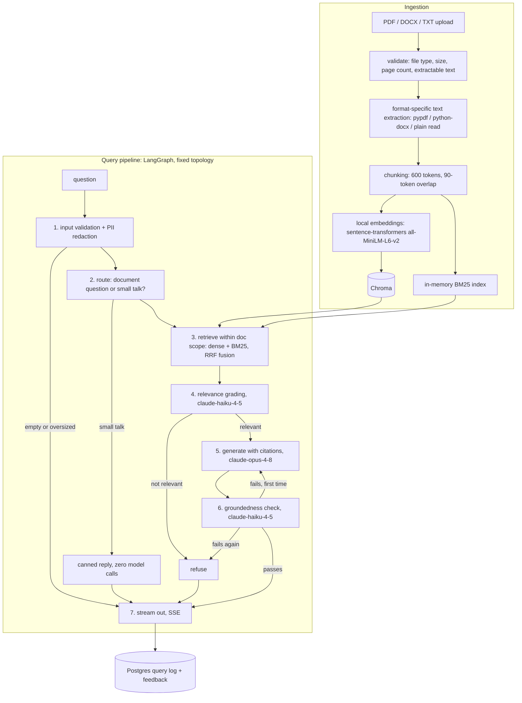

# DocuMind

Ask questions about your documents (PDF, DOCX, TXT). Answers cite the source, and when the document doesn't contain the answer, you get a refusal instead of a guess.

## What it does

Upload documents, ask questions about them in a chat UI. Answers are generated only from text retrieved out of the documents and carry inline citations. If retrieval finds nothing useful, or the generated answer can't be verified against the retrieved text, the system returns an explicit refusal. Queries are scoped to the document you choose (defaulting to the most recent upload), PII in questions is masked before any model call, small talk is answered without running the pipeline at all, and every query is logged to Postgres — with a thumbs up/down feedback loop feeding quality aggregates in `/admin/stats`.

**Model stack**: Anthropic Claude powers every LLM reasoning call — generation on `claude-opus-4-8`, the relevance and groundedness checks on `claude-haiku-4-5`. Embeddings are computed locally with sentence-transformers (`all-MiniLM-L6-v2`): free, no API key, no network call after the one-time model download. See "Why this pairing" below.

## Architecture

Four services under docker compose:

- `frontend` - React + TypeScript (Vite), served by nginx, which also proxies `/api` to the backend
- `backend` - FastAPI running a LangGraph pipeline
- `chroma` - vector store (`chromadb/chroma:1.5.9`, same version as the pinned Python client)
- `postgres` - query/audit log and feedback



## Design decisions

### Why this pairing: Claude for reasoning, local embeddings for retrieval

Every reasoning call — relevance grading, answer generation, the groundedness check — goes to the Anthropic API through one gateway class (`backend/llm.py`); no pipeline code touches an SDK directly, and there is no second LLM provider anywhere in the codebase. Anthropic does not offer an embeddings API, so embeddings are the one piece Claude structurally can't do. Rather than pulling in a second paid provider (with a second API key, second billing relationship, and second failure mode) just for vectors, embeddings run locally with sentence-transformers. This is the natural minimal-dependency split, not a compromise: one key powers everything that reasons, and the embedding path is free, deterministic, and works fully offline once the ~90 MB model has been downloaded and cached.

The checker calls ride `claude-haiku-4-5` because grading and groundedness are cheap yes/no judgments — the same "flagship generates, small model checks" split the project has always used. Both checker calls use the API's structured outputs (a JSON schema the reply must validate against), which is strictly stronger than the old JSON-mode-and-hope approach. Model choices live in config (`GENERATION_MODEL`, `GRADING_MODEL`, `EMBEDDING_MODEL`), not code.

### Document scoping: one document by default, never silently the whole corpus

Every chunk carries its `doc_id`, retrieval filters on it (a Chroma `where` filter for the dense leg; the BM25 leg skips out-of-scope chunks after scoring — a per-scope BM25 index isn't worth building at this corpus size). The query API takes an optional `doc_ids` list; when it's omitted, the scope defaults to the **single most recent upload**, not everything ever ingested. Querying the whole corpus by default invites answers stitched together from unrelated documents; widening the scope is an explicit act (checkboxes in the UI). The scope actually used is logged with every query.

The document list itself is derived from Chroma's chunk metadata (each chunk stores an `uploaded_at` timestamp) rather than kept in a separate table — Chroma already persists everything needed, and a registry would be a second source of truth to keep in sync.

### Multi-format ingestion behind one interface

Every format implements the same contract: bytes in, a list of per-page texts out. Everything downstream of extraction — chunking, embedding, storage, retrieval — is format-agnostic and did not change when DOCX and TXT were added. PDF is the only format with real page numbers; DOCX and TXT return one "page", so their citations degrade to the filename instead of breaking. Unsupported extensions are rejected at upload with a specific 400 listing the supported formats.

### Chunking: per page, 600 tokens, 90-token overlap

Pages are split independently, so every chunk maps to exactly one page number and a citation like "p. 12" is always exact for PDFs. The cost is that no chunk spans a page break, which is acceptable for a citation-first system. 600 tokens is enough for a self-contained passage, and the six chunks that survive fusion fit easily in the generation prompt.

### Hybrid retrieval with reciprocal rank fusion

Dense retrieval (cosine similarity over local MiniLM embeddings in Chroma) handles paraphrase; BM25 handles exact tokens that embeddings dilute, like part numbers, acronyms, and proper nouns. The retriever takes 12 candidates from each leg and fuses them with RRF (`score = sum of 1/(60 + rank)`), keeping the top 6. RRF only uses ranks, which avoids having to calibrate two incomparable score scales against each other.

One real trade of the local model: MiniLM truncates input at 256 word-pieces, so the dense leg embeds roughly the first half of a 600-token chunk. The BM25 leg still scores the full chunk text, which softens the loss, and per-page chunking means the truncated head is usually the topically representative part — but it is a known limitation (listed below) and the first thing to revisit if the eval's context-precision number sags. The backend also fails fast at startup if the Chroma collection was built with a different embedding model (the vectors wouldn't be comparable): wipe the Chroma data and re-upload.

The BM25 index lives in process memory and is rebuilt from Chroma's contents at startup. At this project's scale that rebuild takes milliseconds, so persisting a second index would add complexity for nothing.

### No reranker yet

A cross-encoder reranker is the obvious next retrieval improvement, but it costs latency and another model dependency. The plan is to add one if and when the eval's context-precision score shows that retrieval ordering is the bottleneck. Until there's data saying so, it stays out.

### Query routing: a heuristic, deliberately not an LLM classifier

A routing node in front of retrieval classifies each input as a document question or small talk; greetings and thank-yous get a canned reply with **zero** model calls instead of a full retrieve/grade/generate run that would end in a confusing refusal. The classifier is an anchored regex over whole messages, not a cheap-LLM classification call, for three reasons: an LLM classifier would add cost and latency to *every real query* to catch cases the pipeline already handles safely (a genuinely off-topic question flows through grading and gets a clean refusal); the mistake costs are asymmetric, and the regex is shaped for that — it only fires when the *entire* message is conversational, so "hello, what does section 3 say?" goes through the pipeline, while a missed greeting merely wastes one cheap pipeline run; and a pure function of the input string is replayable and unit-testable, which fits the fixed-pipeline discipline. Which path was taken (`routed_direct` vs `full_pipeline`) is logged with every query.

### PII redaction: regex-based v1, applied at the front door

A redaction step masks emails, phone numbers, SSN-like and credit-card-like patterns in the question (inside input validation) and in retrieved chunk text (once, at the retrieve node) — so the redacted version is what reaches **every** LLM call *and* the Postgres log. The audit log records that redaction happened and which categories were hit, never the matched values.

This is deliberately basic: four regex patterns tuned for precision over recall, no NLP entity recognition, US-centric phone/SSN formats, and no detection of names or addresses. Two consequences worth knowing: retrieval runs on the redacted question, so searching *for* an email address in a document won't match; and PII can still appear in citation snippets shown in the UI, since those come from the user's own uploaded document. If this were going to production, the upgrade path is a dedicated detector with the same mask-and-categorize contract — Microsoft Presidio is the obvious drop-in, or a cloud DLP API.

### Feedback loop: one verdict per query, upserted

Each answer gets thumbs up/down controls (with an optional comment on thumbs-down). Feedback rows live in their own Postgres table keyed to the query log row — and there is exactly **one** feedback row per query, upserted, so adding a comment or changing your mind updates the verdict instead of double-counting it. `/admin/stats` surfaces the aggregates: total feedback, thumbs-down percentage, and the most recent negative-feedback queries with their comments. That is the quality-drift tripwire: a climbing thumbs-down rate flags degrading answers before any outcome count would.

### A fixed pipeline, not an agent

LangGraph here is eight nodes with all edges declared up front. The conditional edges route on deterministic values — a regex verdict and booleans from cheap grading calls — never on a model choosing tools at runtime. Any logged query can be replayed: which path it took and why is fully determined by the recorded state. Cost is bounded and predictable: zero LLM calls for a rejected question or small talk, three on the normal path (grade, generate, groundedness), five in the worst case (a failed check re-runs generation and the check once).

### Refusal instead of hallucination

This was a design goal, not error handling added later. There are three typed non-answer outcomes, each logged distinctly (plus `small_talk` for the routed-direct path):

- `rejected_input` - empty or oversized question, stopped before any model call
- `refused_no_context` - grading judged the retrieved chunks unable to answer the question; the user sees "I don't have enough information in this document to answer that" (or a prompt to upload a document, if nothing has been ingested yet)
- `refused_ungrounded` - the answer failed the groundedness check twice (one retry with the unsupported claims fed back)

Uploads fail loudly too: unsupported file types, files over 20 MB, PDFs over 300 pages, encrypted PDFs, scanned PDFs with no extractable text, and empty DOCX/TXT files each get a specific 400. Embeddings are local, so an embedding/indexing failure during ingestion is a server-side problem and returns a 500 with a message saying exactly that (the pre-migration 502-from-OpenAI case no longer exists).

### Answers are verified before they stream

Raw LLM tokens are never forwarded to the client, because an answer that fails the groundedness check would have to be retracted mid-stream. Instead the SSE stream emits a progress event as each pipeline stage completes, then the verified answer. This costs time-to-first-token and buys never showing the user text that gets taken back.

## Setup

You need Docker and an Anthropic API key. The key powers all LLM reasoning: generation (`claude-opus-4-8`) and the grading/groundedness checks (`claude-haiku-4-5`). Embeddings need no key — the sentence-transformers model (~90 MB) is downloaded from HuggingFace on first startup and cached in a Docker volume after that, so everything embedding-related runs locally and offline.

```bash
cp .env.example .env
# edit .env and set ANTHROPIC_API_KEY - the LLM calls need it
docker compose up --build
```

- Web UI: http://localhost:3000 (set `FRONTEND_PORT` in `.env` if 3000 is taken)
- API docs: http://localhost:8000/docs (set `BACKEND_PORT` in `.env` if 8000 is taken)
- Health check: `GET http://localhost:8000/health`

Setting `API_KEY` in `.env` makes every endpoint except `/health` require that value in an `X-API-Key` header. Leave it empty to run open locally.

### Running without Docker

```bash
# backend - put ANTHROPIC_API_KEY in backend/.env or the environment
cd backend
python -m venv .venv
.venv/Scripts/activate          # source .venv/bin/activate on macOS/Linux
pip install -r requirements.txt
uvicorn main:app --reload
```

```bash
# frontend
cd frontend
npm install
npm run dev                     # Vite proxies /api to localhost:8000
```

Outside Docker the backend uses an embedded on-disk Chroma (`./chroma_db`), and query logging stays disabled unless `DATABASE_URL` points at a Postgres instance (feedback needs it too, since feedback rows link to query log rows).

## Observability

Every query writes one row to Postgres: the (redacted) question, answer, outcome, which route it took (`full_pipeline` or `routed_direct`), which doc_ids retrieval was scoped to, whether PII redaction fired and for which categories, the retrieved chunk IDs with cosine similarity, RRF score, and per-leg (dense/BM25) ranks, both checker verdicts, whether a regeneration happened, and timings for each stage (`retrieval_ms`, `grading_ms`, `generation_ms`, `groundedness_ms`, `total_ms`).

- `GET /admin/logs?limit=20` - recent query rows, newest first
- `GET /admin/stats` - outcome counts, route counts, feedback aggregates (thumbs-down % and recent negative-feedback queries), and avg/p50/p95 latency per stage over the last 200 queries

These exist to make failures detectable in production. A rising `refused_no_context` rate means retrieval is coming back empty-handed; a rising `refused_ungrounded` rate means generation is drifting from its context; a climbing thumbs-down percentage means users disagree with answers the pipeline thought were fine; a p95 spike in one stage column shows where latency went. Logging is fail-open: if Postgres is unreachable or `DATABASE_URL` is unset, the backend logs a warning and keeps serving queries.

Schema note: new columns are added to an existing database automatically at startup by a tiny forward-only migration (`ADD COLUMN` for any model column missing from the table). All post-v1 columns are nullable, which is what makes that safe; if schema changes ever get more interesting than additive nullable columns, the upgrade path is Alembic.

## Testing

```bash
cd backend
pip install -r requirements-dev.txt
python -m pytest tests
```

`tests/unit/` covers chunking edge cases (empty/single-sentence/boundary-sized documents), input validation (empty and oversized queries), file-type validation for all supported and rejected formats, doc-scoping logic (explicit scope, default-to-newest, empty corpus), PII redaction patterns (including false-positive guards on normal technical text), and the small-talk classifier in both directions.

`tests/integration/` runs the real ingestion path (tiny real PDF/DOCX/TXT files into embedded Chroma — embeddings stubbed, everything else real) and the full query path through the FastAPI app with Claude calls replaced by a deterministic fake of the LLM gateway: the small-talk shortcut (asserting **zero** LLM calls), the grading-fails refusal, the ungrounded-retry-then-refuse path (asserting the documented five-call worst case), the normal answer path (asserting checkers ride `claude-haiku-4-5` and generation rides `claude-opus-4-8`), doc scoping end to end, PII never reaching a prompt or the log, and the feedback upsert with its stats aggregates. Log assertions run against SQLite through the same SQLAlchemy models and dialect-neutral queries the Postgres deployment uses — that keeps CI hermetic; Postgres itself is exercised by the compose stack.

The suite runs in GitHub Actions on every push (`.github/workflows/tests.yml`), needs no secrets, and costs nothing. The RAGAS eval is deliberately **not** part of it — see below.

## Evaluation

`backend/eval/` contains 14 hand-written question/answer pairs (`dataset.json`) over `eval/sample.pdf`, a five-page fictional operations manual generated for this repo. The harness (`run_eval.py`) sends each question to the live API, the same code path users hit, then scores the results with RAGAS on two metrics:

- **Faithfulness** - are the answer's claims supported by the retrieved chunks? This is an independent check on the pipeline's own groundedness gate.
- **Context precision** - did retrieval rank the truly relevant chunks at the top? This is the number that would justify adding a reranker.

The judge is `claude-sonnet-4-6` via `langchain-anthropic` (not `claude-opus-4-8`, for a mechanical reason: RAGAS injects a `temperature` parameter into judge calls, which Opus 4.8 rejects — Sonnet 4.6 is the strongest Claude that still accepts sampling parameters). This stays a separate, manually-run step — it is not folded into pytest or CI because it requires a real `ANTHROPIC_API_KEY` and spends real money. To (re)generate the report:

```bash
docker compose up -d
cd backend
.venv/Scripts/pip install -r eval/requirements.txt
.venv/Scripts/python eval/run_eval.py --ingest
```

This uploads `sample.pdf`, runs all 14 questions, and writes `eval/report.md` and `eval/report.json` with per-question scores and means. Questions the pipeline refuses are excluded from scoring and reported separately, since a refusal is a distinct outcome rather than a zero. (`--ingest` also makes `sample.pdf` the most recent upload, so default document scoping points the eval at the right document.)

Latest run (2026-07-15, on the Claude + local-embeddings stack): **faithfulness 1.0, context precision 0.917** over 12 answered questions; 2 of 14 were refused (`refused_no_context`) rather than guessed, consistent with the refusal-first design. The 0.917 context precision — two questions where a relevant chunk ranked below an irrelevant one — is the number to watch against the reranker trigger and the MiniLM truncation limitation.

Note on pins: the eval uses `ragas>=0.4,<0.5`. Older ragas (0.2/0.3) requires the langchain-core 0.3 line, which conflicts with the langchain-core 1.x that langgraph 1.x needs, so 0.4 is the version that lets the app and the eval share one environment.

## API

| Endpoint | Purpose |
|---|---|
| `POST /upload` | Validate and ingest a PDF/DOCX/TXT; 400 with a specific reason on bad input |
| `GET /documents` | Uploaded documents, newest first; the first entry is the default query scope |
| `POST /query` | Full pipeline, single JSON response. Body: `{question, doc_ids?}`; omitting `doc_ids` scopes to the newest upload. Returns `query_id` for feedback |
| `POST /query/stream` | SSE: one `stage` event per completed node, then the verified answer as `token` events, then `citations` and `done` (which carries `query_id`) |
| `POST /feedback` | `{query_id, thumbs_up, comment?}` — upserts the verdict for that query |
| `GET /admin/logs` | Recent query logs |
| `GET /admin/stats` | Outcome/route counts, feedback aggregates, per-stage latency percentiles |
| `GET /health` | Liveness and indexed chunk count |

## Known limitations

- **Formats**: only PDF, DOCX, and TXT. CSV, HTML, and structured clinical/financial formats (e.g. FHIR bundles) are future work, not built now, and deliberately so — each needs structure-aware handling (rows and headers, DOM semantics, typed resources), not just text extraction, and pretending a CSV is prose would produce confidently wrong retrieval. The extraction interface is one function per format, so adding them is contained.
- **DOCX**: text inside tables is skipped (the upload response warns when that happens), and DOCX/TXT have no page numbers, so their citations point at the file rather than a page.
- Scanned or image-only PDFs are rejected at upload with a clear error. There is no OCR.
- **PII redaction is a basic v1**: four regex patterns (email, phone, SSN-like, card-like), precision-tuned and US-centric. It does not catch names, addresses, unseparated digit runs, or non-US formats, retrieval runs on the redacted query (searching for an email address won't match it), and citation snippets in the UI can still show PII from the user's own document. Production upgrade path: Microsoft Presidio or a cloud DLP API behind the same mask-and-categorize contract.
- **The small-talk classifier is an English-centric pattern list.** A French "bonjour" runs the full pipeline and gets a refusal — safe, just not free.
- **Embedding truncation**: `all-MiniLM-L6-v2` embeds at most 256 word-pieces, so the dense leg sees roughly the first half of a 600-token chunk (BM25 still sees all of it). The model is also small (384-dim) — a deliberate free-and-local trade. Upgrade path if context precision needs it: a larger local model (`bge-small`/`gte-base`) or smaller chunks.
- No reranker. See above for the trigger that would add one.
- The BM25 index is per-process, which is correct for one backend replica and wrong for several. Scaling out would mean moving sparse search into shared infrastructure, e.g. Postgres full-text search.
- Chroma and Postgres are single-node with no HA. At much larger document volumes the plan would be pgvector or a managed vector store, queue-based ingestion, an embedding cache keyed by chunk hash, and sampled rather than per-query groundedness checks.
- The groundedness check is itself an LLM judgment (claude-haiku-4-5), a strong spot-check but not a proof. The offline faithfulness metric exists as an independent audit of it.
- Single-tenant: one shared API key, one document namespace, no per-user isolation. Documents can be scoped per query, but there is no per-user ownership and no way to delete a document yet short of clearing the Chroma volume.
- Time-to-first-token on document questions is a full pipeline run, which is the price of verifying answers before streaming them. (Small talk returns instantly — it skips the pipeline.)
